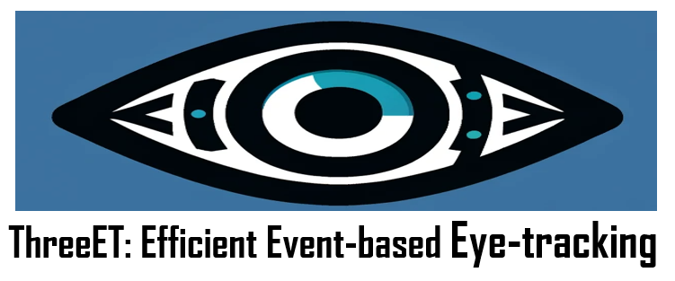
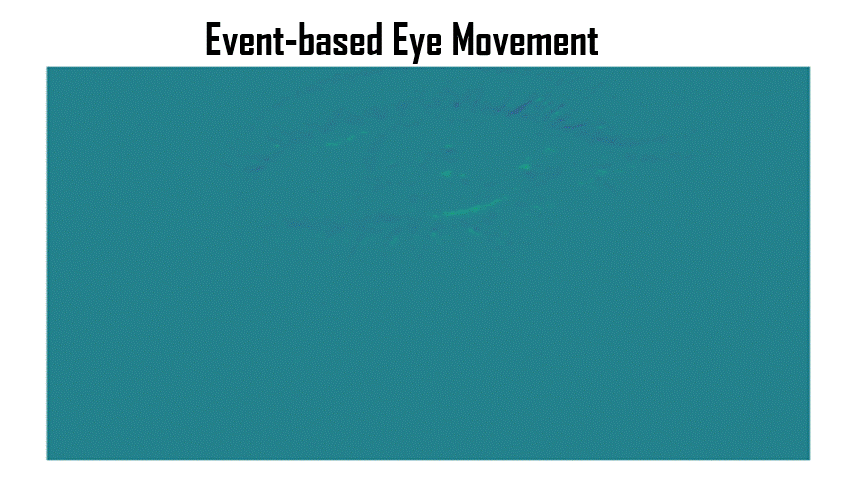
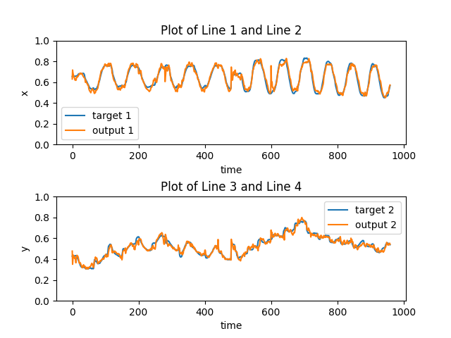

<p align="center">
  
</p>

# 3ET: Efficient Event-based Eye Tracking using a Change-Based ConvLSTM Network

Code and synthetic event data resources for pupil-center tracking with
ConvLSTM and Change-Based ConvLSTM networks.

> **Reproducibility notice.** The paper reports 22 selected LPW recordings and
> an 80/20 data allocation. The exact 22 recording IDs, the unit and procedure
> used for that allocation, and the eye-movement-speed calculation have not
> been recovered. The repository's existing 16/2 lists are now frozen as
> **`SEET-public-v1`**, the official public dataset split for all benchmark
> results reported from this repository going forward. It is recording-disjoint
> and is not claimed to reconstruct the original paper split.

<p align="center">
  
</p>

The paper uses “3ET” for the event-based eye-tracking solution. This
repository uses “SEET” when naming the v2e-derived synthetic data artifacts
and their splits, so an experiment can cite an exact split rather than an
ambiguous dataset name.

## Official public dataset split

Use [`SEET-public-v1`](splits/SEET-public-v1/manifest.json) as the canonical
train/validation split for public SEET comparisons:

- 16 training recordings and 2 validation recordings;
- no complete recording ID appears in both partitions;
- subject 18 appears in both partitions through different recordings, so the
  split is recording-disjoint but **not subject-disjoint**;
- the legacy files at `eyetracking-convlstm/train_files.txt` and
  `eyetracking-convlstm/val_files.txt` remain unchanged for compatibility.

The 16/2 membership is the official public split even though it differs from
the incomplete protocol description in the paper. Benchmark results must name
`SEET-public-v1`; neither the 18/2 Drive folder inventory nor the historical
Tonic manifests define the official split.

All known split variants and their provenance are in the
[`splits/`](splits/README.md) registry. Validate them with:

```bash
python3 tools/validate_splits.py
```

## Data artifacts

| Resource | Contents observed | Split status |
| --- | --- | --- |
| [Preprocessed event frames](https://drive.google.com/drive/folders/16qH_wv_oVNysJARtHIUrIXbHjOygfq_i) | 18 train + 2 validation recording directories | Recording-disjoint artifact inventory: `SEET-eventframes-v0` |
| [Raw events and AVI files](https://drive.google.com/drive/folders/1HeOS5YBLruzHjwMKyBQfVTc_mJbsy_R1) | Raw v2e event streams, frame timestamps, labels/videos where available | Source recordings; no benchmark split implied |
| [Historical Tonic download](splits/SEET-tonic-legacy-v0/manifest.json) | 62 raw event HDF5 files and 62 label files; bundled manifests select 16 train + 2 validation entries (17 unique) | Raw data reusable; bundled split deprecated because `subj_18_vid_7` occurs in both train and validation |

The downloadable artifacts do not establish the paper's 22 recording IDs.
See [`DATASET_AUDIT.md`](DATASET_AUDIT.md) for the complete inventory, archive
fingerprints, missing raw recordings, and pipeline differences.

The original RGB source dataset is [Labeled Pupils in the Wild
(LPW)](https://www.mpi-inf.mpg.de/departments/computer-vision-and-machine-learning/research/gaze-based-human-computer-interaction/labelled-pupils-in-the-wild-lpw).

## Using the legacy preprocessed pipeline

The legacy scripts contain hard-coded paths, so inspect and update them for
your machine before running.

1. Download the **preprocessed event-frame** artifact and arrange the tensor
   and label directories described in [`DATASET_AUDIT.md`](DATASET_AUDIT.md).
2. Change to the code directory:

   ```bash
   cd eyetracking-convlstm
   ```

3. If starting from intermediate HDF5 files containing a `/vector` array, edit
   the input/output paths and sequence settings in `process_event.py`, then
   run:

   ```bash
   python3 process_event.py
   ```

4. Point `convlstm-et-pytorch-event.py` at the windowed tensors and labels,
   then run:

   ```bash
   python3 convlstm-et-pytorch-event.py
   ```

`process_event.py` creates sequence windows; it is **not** a converter for the
raw v2e HDF5 files. Raw events require a separate event representation step.

## Loading raw events with Tonic

[Tonic](https://github.com/neuromorphs/tonic) can download and load event data
for subsequent transformation into event frames or another representation:

Until split versioning is available in a Tonic release, install the reviewed
fix from the exact commit recorded here (the commit is also linked from the
Tonic pull request):

```bash
pip install "git+https://github.com/qinche106/tonic.git@7dbd4c94eebfdf5882980c34a8c455da37848566"
```

After an upstream release includes the new API, pin that Tonic release instead.

```python
import tonic

trainset = tonic.datasets.ThreeET_Eyetracking(
    save_to="./data",
    split="train",
    split_version="public_v1",
)
valset = tonic.datasets.ThreeET_Eyetracking(
    save_to="./data",
    split="val",
    split_version="public_v1",
)

events, targets = next(iter(trainset))
```

Split names are lowercase. Before reporting a benchmark, verify that your
installed Tonic version uses recording-disjoint lists matching the intended
manifest. The raw files in the historical archive remain reusable. Only its
bundled legacy split manifests contain complete-recording leakage and must not
be used for evaluation.

## Results

The first released `SEET-public-v1` reference row is a fresh 100-epoch run of
the repository's vanilla public-code ConvLSTM. It is **not** a CB-ConvLSTM
execution result.

| Protocol | Seed | P3 | P5 | P10 | Mean error | Validation loss | Best epoch | Parameters |
| --- | ---: | ---: | ---: | ---: | ---: | ---: | ---: | ---: |
| `SEET-public-v1-convlstm-code-v1` | 1 | 87.500% | 98.958% | 99.688% | 1.63025 px | 0.000206204 | 83 | 416,882 |

These are **validation-only, single-seed** measurements on the two official
validation recordings (24 sequences, 960 evaluated points), not held-out test
results or uncertainty estimates. P3/P5/P10 use the corrected `x*80,y*60`
Euclidean pixel distance and strict `distance < threshold`. An independent
evaluation job reproduced every primary and legacy diagnostic metric exactly.

The canonical machine-readable row is
[`results/seet_public_v1_results.csv`](results/seet_public_v1_results.csv).
The [complete result bundle](results/SEET-public-v1-convlstm-code-v1/) includes
the best checkpoint, full metadata, all 100 history records, and the independent
evaluation outputs. The published paper Table II is not relabeled as an
official-split result because its exact data allocation cannot be verified.

The historical qualitative prediction plot after 28 epochs is retained below:



See [`results/README.md`](results/README.md) for exact hashes, execution
provenance, the independent-evaluation record, and interpretation limits.

The reproducible vanilla ConvLSTM reference runner is documented in
[`tools/README_SEET_PUBLIC_V1.md`](tools/README_SEET_PUBLIC_V1.md). It freezes
the current public-code training protocol, fixes the old train/eval mode and
validation-weighting bugs, and reports the corrected `x*80,y*60` pixel metric.
It is a new public-code benchmark, not a reconstruction of the paper's
unrecovered experiment.

## Paper and citation

The paper was published at IEEE BioCAS 2023. The
[arXiv version](https://arxiv.org/abs/2308.11771) is openly available.

```bibtex
@INPROCEEDINGS{3et,
  author={Chen, Qinyu and Wang, Zuowen and Liu, Shih-Chii and Gao, Chang},
  booktitle={2023 IEEE Biomedical Circuits and Systems Conference (BioCAS)},
  title={3ET: Efficient Event-based Eye Tracking using a Change-Based ConvLSTM Network},
  year={2023},
  pages={1-5},
  doi={10.1109/BioCAS58349.2023.10389062}
}
```

A related eye-tracking game demo was developed at the Telluride Workshop 2023:
[video](https://www.youtube.com/watch?v=aRB5mDNfrHM).
